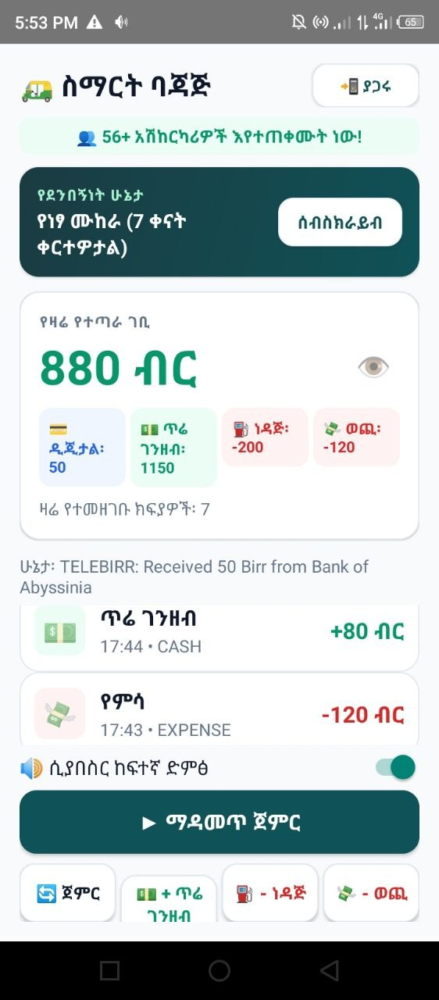

# 🚕 የባጃጅ ሹፌሮች አፕ | Smart Bajaj

**በባጃጅ ሥራ ላይ ሳሉ የTelebirr ወይም የንግድ ባንክ (CBE) ክፍያ ማሳወቂያዎችን በአማርኛ ወይም በእንግሊዝኛ ድምፅ ይስሙ።**

[📥 አፑን አውርዱ](<https://t.me/smartbajaj/5>) · [Telegram ድጋፍ: @zappyt](<https://t.me/zappyt>)

## የአፕ ማሳያ | App dashboard

## ስለ አፑ

Smart Bajaj ለባጃጅ ሹፌሮች የተዘጋጀ አፕ ነው። ስልክዎን ሳያዩ የገቢ ክፍያ ማሳወቂያዎችን በድምፅ እንዲሰሙ፣ የቀን ገቢና የነዳጅ ወጪዎን እንዲከታተሉ እና የተጣራ ትርፍዎን እንዲያውቁ ያግዛል።

## ዋና ባህሪያት

- **የድምፅ የክፍያ ማሳወቂያ:** የTelebirr ወይም CBE የገቢ ክፍያ ማሳወቂያ ሲደርስ በአማርኛ ወይም በእንግሊዝኛ ያሳውቃል።
- **የሐሰተኛ screenshot ማጭበርበርን ለመቀነስ:** በሌላ ሰው የታየ screenshot ላይ ብቻ ከመመርኮዝ ይልቅ የደረሰውን የክፍያ ማሳወቂያ ይመልከቱ።
- **ምዝገባ አያስፈልግም:** ስም፣ ስልክ ቁጥር ወይም የይለፍ ቃል አያስገቡም።
- **PIN አይጠይቅም:** የTelebirr ወይም የባንክ PIN አይጠይቅም።
- **የገቢና ወጪ ክትትል:** የቀን ገቢና የነዳጅ ወጪ ይመዝግቡ፤ የተጣራ ትርፍዎን በTelegram Saved Messages ያስቀምጡ።

## የክፍያ እቅድ

- የመጀመሪያዎቹ **7 ቀናት ነፃ** ሙከራ።
- ከዚያ በኋላ **በወር 30 ብር**።
- የጋበዙት ጓደኛ የመጀመሪያውን ወር ሲከፍል **5 ቀን ነፃ ቦነስ** ያግኙ። 6 የሚከፍሉ ጓደኞች ሲኖሩዎት 30 ቀን ቦነስ ያገኛሉ።

## አፑን ማውረድና መጫን

1. [የSmart Bajaj ፋይልን ከTelegram ያውርዱ](<https://t.me/smartbajaj/5>)።
2. የወረደውን ፋይል ይክፈቱና **Install** ይጫኑ።
3. Android ከጠየቀ፣ ለሚጠቀሙበት መተግበሪያ **Allow from this source** ፍቃድ ይስጡ። ፋይሉን ከላይ ያለው ኦፊሴላዊ የTelegram ሊንክ ብቻ ያውርዱ።

## እገዛ

ጥያቄ ወይም እገዛ ካስፈለገዎት [@zappyt በTelegram ያግኙ](<https://t.me/zappyt>)።

---

## English

Smart Bajaj helps Ethiopian bajaj drivers hear incoming **Telebirr and Commercial Bank of Ethiopia (CBE) payment notifications** in Amharic or English, without needing to look at the phone while working.

### Features

- **Spoken payment alerts:** Hear when an incoming Telebirr or CBE payment notification arrives.
- **Help avoid screenshot-based payment scams:** Check the received payment notification instead of relying only on a screenshot shown by someone else.
- **No registration:** No name, phone number, or password is required.
- **No PIN requests:** The app does not ask for a Telebirr or bank PIN.
- **Income and fuel tracking:** Track daily income and fuel expenses, calculate net profit, and save the daily summary to Telegram Saved Messages.

### Trial, pricing, and referrals

- Try the app free for the first **7 days**.
- Continue for **30 ETB per month** after the trial.
- Earn **5 free days** when a referred friend pays for their first month. Six qualifying referrals earn 30 free days.

### Download and install

1. [Download the Smart Bajaj app from Telegram](<https://t.me/smartbajaj/5>).
2. Open the downloaded file and tap **Install**.
3. If Android prompts you, allow installs for the app you used to download the file. Only download it from the official Telegram link above.

### Support

For help, contact [@zappyt on Telegram](<https://t.me/zappyt>).

This repository contains app information and documentation only; it does not include the application source code or APK.
